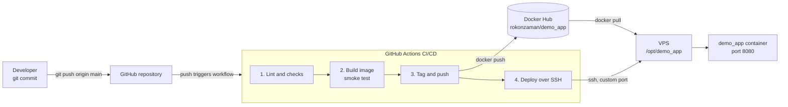

# DevOps Task

A minimal Node.js web service that replies to `GET /` with:

```json
{"message":"Hello from DevOps Intern Task!","status":"running"}
```

Around the app there is a production-ready container setup, a GitHub Actions pipeline
that tests, builds, and ships the image to Docker Hub and a VPS, and a small Bash script
that reports system health.

## Repository layout

```text
.
├── server.js                 # the app: one HTTP server, no dependencies
├── Dockerfile                # multi-stage build, runs as non-root
├── docker-compose.yml        # local run on port 8080
├── .env                      # IMAGE_TAG for compose (no secrets)
├── scripts/system_health.sh  # CPU / memory / disk reporter
├── eslint.config.js
├── package.json              # app version used as the image tag
└── .github/workflows/ci.yml  # lint -> build -> push -> deploy
```

## Run it locally

```bash
docker compose up -d --build
curl http://localhost:8080/
# {"message":"Hello from DevOps Intern Task!","status":"running"}
```

### Why the image is built this way

- Multi-stage build on `node:22-alpine`: `npm ci` runs in a builder stage, and the
  runtime stage only carries the app, so the final image stays around 60 MB
- `npm ci --omit=dev` keeps lint tooling out of the image
- Runs as the non-root `node` user with `NODE_ENV=production` and a container `HEALTHCHECK`
- Compose adds `read_only`, `no-new-privileges`, and `init` for tighter container hygiene

## System health script

`scripts/system_health.sh` samples CPU usage (from `/proc/stat` over one second),
memory usage, and disk usage, then appends a timestamped line to `health_log.txt` next
to the script. When disk usage exceeds 80% it also prints `[WARNING] Disk space high!`.

```bash
chmod +x scripts/system_health.sh
./scripts/system_health.sh        # or simply: bash scripts/system_health.sh
cat scripts/health_log.txt
```

Example output:

```text
[2026-10-16 04:29:37] CPU: 53.9% | Memory: 77.7% | Disk: 85%
[WARNING] Disk space high!
```

To keep an eye on a machine, schedule it with cron:

```cron
*/5 * * * * /opt/demo_app/scripts/system_health.sh
```

Recommended extension — Slack / Mattermost alerts.

After a deploy, the script is also available on the server, so you can run it over SSH:

```bash
ssh -p <vps-port> <vps-user>@<vps-host> 'sudo /opt/demo_app/scripts/system_health.sh && cat /opt/demo_app/scripts/health_log.txt'
```

## CI/CD pipeline

Every push to `main` triggers `.github/workflows/ci.yml`, which takes the commit all the
way to a running container on the server:



| Job | What it does |
| --- | --- |
| `lint` | `npm ci`, ESLint, `node --check server.js` |
| `build` | Builds the image with Buildx (no push) to prove the build works, then starts it and checks the JSON response |
| `push-image` | Tags the image with the `package.json` version plus a `sha-<short-sha>` tag for traceability, and pushes both to `rokonzaman/demo_app` |
| `deploy` | Copies `docker-compose.yml`, `.env`, and the health script to `/opt/demo_app` with `scp`, installs Docker/Compose if needed, and runs `docker compose pull && up -d` over SSH |

### One-time setup

The pipeline needs a few repository settings (Settings → Secrets and variables → Actions):

| Kind | Name | Value |
| --- | --- | --- |
| Secret | `DOCKERHUB_TOKEN` | Docker Hub access token for `rokonzaman` (Read & Write) |
| Secret | `VPS_SSH_KEY` | Private deploy key for the VPS |
| Variable | `VPS_HOST` | VPS IP address or hostname |
| Variable | `VPS_USER` | SSH user, e.g. `demo_user` |
| Variable | `VPS_PORT` | Custom SSH port, e.g. `2222` |

Create the deploy key once and authorize it on the server:

```bash
ssh-keygen -t ed25519 -C "github-actions" -f deploy_key -N ""
ssh-copy-id -i deploy_key.pub -p <vps-port> <vps-user>@<vps-host>
# put the output of `cat deploy_key` into the VPS_SSH_KEY secret
```

The SSH user needs passwordless `sudo` (the default on most cloud images). Docker and
the Compose plugin are installed by the workflow on its first run; just make sure the
SSH port (and 8080, if the app should be publicly reachable) is open in the firewall.

To deploy or restart manually on the server, the compose file reads the version from
`/opt/demo_app/.env`:

```bash
cd /opt/demo_app
sudo docker compose pull
sudo docker compose up -d
```

## Deploying to AWS (EC2)

- **Provision**: a small Ubuntu EC2 instance with an Elastic IP; open the custom SSH
  port and 8080 in the security group (add an ALB or nginx in front if you need TLS)
- **Ship it the same way**: install Docker + Compose via cloud-init/user-data or reuse
  this repo's deploy job, then `docker compose pull && docker compose up -d` from
  `/opt/demo_app` — the image comes from Docker Hub, nothing is built on the server
- **Going further**: push to ECR instead of Docker Hub and run it on ECS Fargate behind
  an ALB; for a single VM, EC2 + Compose with `restart: unless-stopped` is enough

## Versioning

The image tag follows `version` in `package.json` (currently `1.0.2`), mirrored in `.env`
for local runs. To release: bump both, commit, push to `main`. CI publishes
`rokonzaman/demo_app:<version>` (plus the immutable `sha-<short-sha>` tag, handy for
rollbacks like `IMAGE_TAG=sha-<short-sha> docker compose up -d`) and deploys it.
