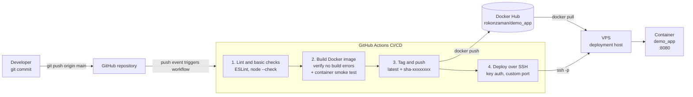

# DevOps Intern Task

Minimal Node.js service exposing `GET /`:

```json
{"message":"Hello from DevOps Intern Task!","status":"running"}
```

## Run locally

```bash
docker compose up -d --build
curl http://localhost:8080/
```

## End-to-end pipeline



### Workflow (.github/workflows/ci.yml)

Triggers on every push to `main` (and manual `workflow_dispatch`).

| Job | Purpose |
| --- | --- |
| `lint` | `npm ci`, ESLint, `node --check server.js` |
| `build` | Builds the Docker image with Buildx (no push) to verify there are no build errors, then starts the container and checks the JSON response |
| `push-image` | Logs in to Docker Hub as `rokonzaman`, tags the image `latest` and `sha-<short-sha>`, and pushes it to `rokonzaman/demo_app` |
| `deploy` | Installs Docker and Docker Compose on the VPS if missing, deploys to `/opt/demo_app` over SSH with key auth on a custom port (all via `sudo`), pulls `latest`, runs `docker compose up -d`, and verifies the JSON response |

### Required GitHub secrets and variables

Add these under **Settings → Secrets and variables → Actions**.

Secrets (sensitive, encrypted):

| Secret | Description |
| --- | --- |
| `DOCKERHUB_TOKEN` | Docker Hub access token for `rokonzaman` with Read & Write permission |
| `VPS_SSH_KEY` | Private deploy key (`cat deploy_key`) |

Variables (non-sensitive, plaintext):

| Variable | Description |
| --- | --- |
| `VPS_HOST` | VPS IP address or hostname |
| `VPS_USER` | SSH user on the VPS (e.g. `ubuntu`) |
| `VPS_PORT` | Custom SSH port (e.g. `2222`) |

### Deploying to a VPS (SSH key auth, custom port)

The `deploy` job runs automatically after `push-image`. It connects to the VPS with key auth on a custom SSH port, installs Docker and the Docker Compose plugin (Ubuntu/Debian) if they are missing, writes the Compose file to `/opt/demo_app`, and runs the stack with `sudo docker compose up -d`.

Setup:

1. Generate a dedicated deploy key pair:

   ```bash
   ssh-keygen -t ed25519 -C "github-actions" -f deploy_key -N ""
   ```

2. Install the public key on the VPS:

   ```bash
   ssh-copy-id -i deploy_key.pub -p <vps-port> <vps-user>@<vps-host>
   ```

3. Add repository variables `VPS_HOST`, `VPS_USER`, `VPS_PORT` and the secret `VPS_SSH_KEY` (the private key, i.e. `cat deploy_key`).

4. The SSH user must be able to run `sudo` without a password prompt (default on most cloud images). Open the SSH port and port 8080 (if the app should be reachable publicly) in the firewall. Docker and Docker Compose are installed automatically on the first run.

Manual deploy on the VPS, if needed:

```bash
cd /opt/demo_app
sudo docker compose pull
sudo docker compose up -d
```

Standalone equivalent:

```bash
sudo docker pull rokonzaman/demo_app:latest
sudo docker rm -f demo_app
sudo docker run -d --name demo_app -p 8080:8080 --restart unless-stopped \
  rokonzaman/demo_app:latest
```
