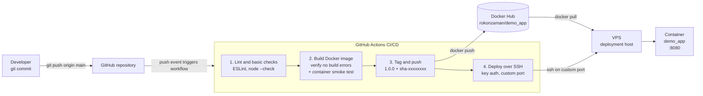

# DevOps Intern Task

Minimal Node.js service exposing `GET /`:

```json
{"message":"Hello from DevOps Intern Task!","status":"running"}
```

## Run locally

```bash
docker compose up -d --build
curl http://localhost:8080/
```

The legacy v1 syntax `docker-compose up -d --build` works as well. Compose reads `IMAGE_TAG` from `.env`.

## System health script

`scripts/system_health.sh` logs CPU, memory, and disk usage with a timestamp into `health_log.txt` (created next to the script) and prints `[WARNING] Disk space high!` when disk usage exceeds 80%.

```bash
chmod +x scripts/system_health.sh
./scripts/system_health.sh
```

Without the executable bit it can also be run via the interpreter:

```bash
bash scripts/system_health.sh
```

Example output:

```text
[2026-10-16 04:21:27] CPU: 85.6% | Memory: 79.6% | Disk: 85%
[WARNING] Disk space high!
```

To monitor continuously, schedule it with cron (for example, every 5 minutes):

```cron
*/5 * * * * /opt/demo_app/scripts/system_health.sh
```

### Run the script on the VPS

The deploy job installs the script at `/opt/demo_app/scripts/system_health.sh`, so the evaluator can run it with the deploy key:

```bash
ssh -p <vps-port> <vps-user>@<vps-host>
/opt/demo_app/scripts/system_health.sh
cat /opt/demo_app/scripts/health_log.txt
```

Or remotely in one shot:

```bash
ssh -p <vps-port> <vps-user>@<vps-host> '/opt/demo_app/scripts/system_health.sh && cat /opt/demo_app/scripts/health_log.txt'
```

Alternatively, clone the repository on the VPS and run `scripts/system_health.sh` from there.

## End-to-end pipeline



### Workflow (.github/workflows/ci.yml)

Triggers on every push to `main` (and manual `workflow_dispatch`).

| Job | Purpose |
| --- | --- |
| `lint` | `npm ci`, ESLint, `node --check server.js` |
| `build` | Builds the Docker image with Buildx (no push) to verify there are no build errors, then starts the container and checks the JSON response |
| `push-image` | Logs in to Docker Hub as `rokonzaman`, tags the image with the `package.json` version and `sha-<short-sha>`, and pushes it to `rokonzaman/demo_app` |
| `deploy` | Installs Docker and Docker Compose on the VPS if missing, copies `docker-compose.yml`, `.env`, and `scripts/system_health.sh` (into `/opt/demo_app/scripts/`) over `scp` (key auth, custom port), runs `docker compose pull` and `up -d` with the `package.json` version tag via `sudo`, and verifies the JSON response |

### Required GitHub secrets and variables

Add these under **Settings → Secrets and variables → Actions**.

Secrets (sensitive, encrypted):

| Secret | Description |
| --- | --- |
| `DOCKERHUB_TOKEN` | Docker Hub access token for `rokonzaman` with Read & Write permission |
| `VPS_SSH_KEY` | Private deploy key (`cat deploy_key`) |

Variables (non-sensitive, plaintext):

| Variable | Description |
| --- | --- |
| `VPS_HOST` | VPS IP address or hostname |
| `VPS_USER` | SSH user on the VPS (e.g. `ubuntu`) |
| `VPS_PORT` | Custom SSH port (e.g. `2222`) |

### Versioning

The image tag comes from `version` in `package.json` (currently `1.0.2`) and from `IMAGE_TAG` in `.env` (no secrets in it, just the tag). To release a new version:

1. Bump `version` in `package.json` and `IMAGE_TAG` in `.env`
2. Commit and push to `main`

CI then pushes `rokonzaman/demo_app:<version>` (plus `sha-<short-sha>` for traceability) and deploys that exact version. During deploy, CI writes `/opt/demo_app/.env` with the `package.json` version, so even manual `docker compose` commands on the VPS always use the deployed version.

### Deploying to AWS (EC2)

- Provision a small Ubuntu EC2 instance, attach an Elastic IP, and open the custom SSH port and 8080 in the security group (put an ALB or nginx in front if you need TLS)
- Bootstrap it by installing Docker + the Compose plugin (cloud-init/user-data or the same SSH-based GitHub Actions deploy job used for the VPS), then `docker compose pull && docker compose up -d` from `/opt/demo_app` — the image comes from Docker Hub, nothing is built on the server
- For more scale/availability, push to ECR instead of Docker Hub and run the container on ECS Fargate behind an ALB; for a single VM, EC2 + Compose with `restart: unless-stopped` is enough

### Deploying to a VPS (SSH key auth, custom port)

The `deploy` job runs automatically after `push-image`. It connects to the VPS with key auth on a custom SSH port, installs Docker and the Docker Compose plugin (Ubuntu/Debian) if they are missing, copies `docker-compose.yml`, `.env`, and `scripts/system_health.sh` (into `/opt/demo_app/scripts/`) from the repository to `/opt/demo_app`, and runs the stack with `sudo IMAGE_TAG=<package.json version> docker compose up -d`.

Setup:

1. Generate a dedicated deploy key pair:

   ```bash
   ssh-keygen -t ed25519 -C "github-actions" -f deploy_key -N ""
   ```

2. Install the public key on the VPS:

   ```bash
   ssh-copy-id -i deploy_key.pub -p <vps-port> <vps-user>@<vps-host>
   ```

3. Add repository variables `VPS_HOST`, `VPS_USER`, `VPS_PORT` and the secret `VPS_SSH_KEY` (the private key, i.e. `cat deploy_key`).

4. The SSH user must be able to run `sudo` without a password prompt (default on most cloud images). Open the SSH port and port 8080 (if the app should be reachable publicly) in the firewall. Docker and Docker Compose are installed automatically on the first run.

Manual deploy or restart on the VPS, if needed (`IMAGE_TAG` is read from `/opt/demo_app/.env`):

```bash
cd /opt/demo_app
sudo docker compose pull
sudo docker compose up -d
```

Standalone equivalent:

```bash
sudo docker pull rokonzaman/demo_app:<version>
sudo docker rm -f demo_app
sudo docker run -d --name demo_app -p 8080:8080 --restart unless-stopped \
  rokonzaman/demo_app:<version>
```
