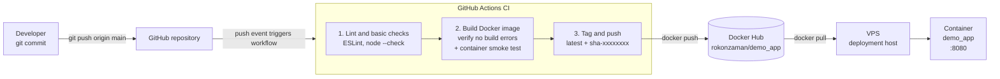

# DevOps Intern Task

Minimal Node.js service exposing `GET /`:

```json
{"message":"Hello from DevOps Intern Task!","status":"running"}
```

## Run locally

```bash
docker compose up -d --build
curl http://localhost:8080/
```

## End-to-end pipeline



### Workflow (.github/workflows/ci.yml)

Triggers on every push to `main` (and manual `workflow_dispatch`).

| Job | Purpose |
| --- | --- |
| `lint` | `npm ci`, ESLint, `node --check server.js` |
| `build` | Builds the Docker image with Buildx (no push) to verify there are no build errors, then starts the container and checks the JSON response |
| `push-image` | Logs in to Docker Hub as `rokonzaman`, tags the image `latest` and `sha-<short-sha>`, and pushes it to `rokonzaman/demo_app` |

### Required GitHub secrets

| Secret | Description |
| --- | --- |
| `DOCKERHUB_TOKEN` | Docker Hub access token for `rokonzaman` with Read & Write permission |

### Deploying to a VPS

On the VPS, after CI pushes a new image:

```bash
docker pull rokonzaman/demo_app:latest
docker run -d --name demo_app -p 8080:8080 --restart unless-stopped \
  rokonzaman/demo_app:latest
```

Or keep the repository on the VPS and run `docker compose pull && docker compose up -d`.
